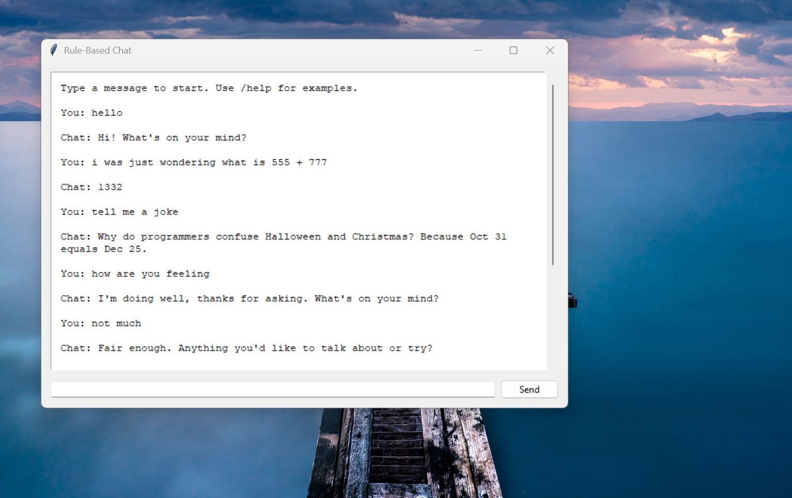

# Rule-Based Chat

A local English-language chatbot built with Python's standard library. It uses phrase and keyword matching, session memory, and built-in tools to respond. Replies are deterministic and the app makes no network calls.



## Run it

With Python 3.10 or newer, open the desktop window from the repository folder.

```sh
python chat_window.pyw
```

The desktop window uses Tkinter. You can also run the terminal chat and see which rule handled each message.

```sh
python app.py --trace
```

## Try it

- `Not much, I was just wondering what is 555 + 222` works as a calculation. Follow up with `then multiply by 3`.
- `Where is Paris?` looks up a built-in location. Follow up with `What about Tokyo?`.
- `Explain recusion` offers a possible correction and waits for confirmation.
- `Can you count the words in this: Hello, new world!` runs a text tool.
- `Remember that my favorite color is blue` saves a note for the current session. Ask `What's my favorite color?` to recall it.

Use `/help` for more examples. Unknown requests may get a clarifying question. `/reset` clears your session, and `/quit` exits.
